# bzintersection
Implicitization法によるベジェ曲線間の交点検出 Bézier Curve-Curve Intersection Detection Using Implicitization Method

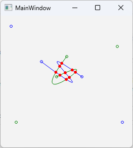

以下の記事に掲載した、Implicitization法により、3次ベジェ曲線間の交点を検出するサンプルアプリです。 
This is a sample application that detects intersection points between cubic Bézier curves by using implicitization method, as featured in the post below. 
[Qiita - Implicitization法によるベジェ曲線の交点検出 ～ 代数方程式の実用的解法の検討と実装 ～](https://qiita.com/kumanomi1000/items/8627ad15ac9315194bfc) 
[Qiita - Intersection Detection of Bézier Curves Using the Implicitization Method — A Study and Implementation of Practical Methods for Solving Algebraic Equations —](https://qiita.com/kumanomi1000/items/bf69f2c32d52cc13b93b) 

- bzintersection.cpp 実装例ソースコード Implementation example
- bzintersection.pro main.cpp, mainwindow.h, mainwindow.cpp, mainwindow.ui, scene.cpp, scene.h Qtサンプルアプリ 起動すると上記のEx.3（ただし座標値10倍、上下反転）が表示される。 
制御点をドラッグして移動すると曲線が更新され、交点が更新される。 
Qt Sample Application 
When you start the program, Ex.3 in above (with the coordinate values multiplied by 10 and upside down) will be displayed. 
Dragging and moving the control points will update the curve and intersection points. 
- bzintersection.zip Windows 11上のQt 6.9.1 + MSVC2022 64bitでビルドした実行ファイル。Qtランタイムライブラリが必要。 Executable built on Windows 11 using Qt 6.9.1 and MSVC2022 64-bit. Requires Qt runtime libraries.
- paper_j.pdf, paper_e.pdf 論文pdf / article pdf

折れ線近似法やサブディビジョン法と異なり、交点の1次微分が一致している場合や、交差ではなく1点で接している場合にも正しく交点を求めることができます。
また、陰伏方程式の次数が下がる場合や重根となる場合にも対応しており、例外的なケースが含まれる下記例いずれについても正しく交点を求めることができます： 
Unlike the polygonal approximation or subdivision methods, this approach can correctly identify intersection points even when the first derivatives of the curves coincide at the intersection, or when the curves are contacting at a single point rather than crossing.
It also handles cases where the degree of the implicit equation is reduced or where multiple roots occur, ensuring accurate detection of intersection points in all of the following examples, which include such exceptional cases:

<table>
<tr><td>Ex.1</td><td>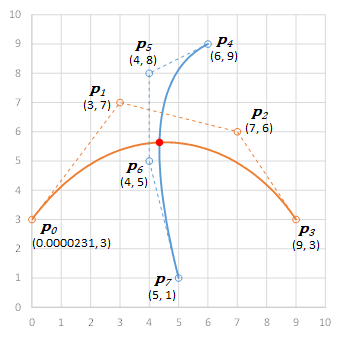</td><td>1点で交差 Intersects at one point  絶対値が大きい根が含まれる Roots with large absolute value are included</td></tr>
<tr><td>Ex.2</td><td>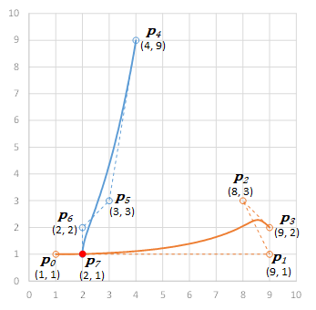</td><td>1点で交差 Intersects at one point  パラメータの値域上限に近い根が含まれる Roots close to the upper bound of the parameter's range are included</td></tr>
<tr><td>Ex.3</td><td>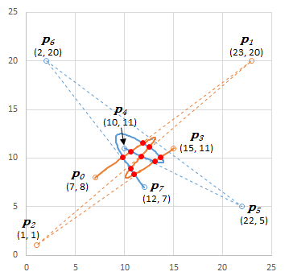</td><td>9点で交差 Intersects at nine points  根はいずれも実数かつパラメータの値域内 All roots are real numbers and lie within the parameter's range</td></tr>
<tr><td>Ex.4</td><td>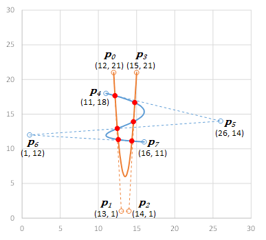</td><td>${\boldsymbol{B}}_0$ が2次 ${\boldsymbol{B}}_0$ is quadratic  陰伏方程式は6次 Implicit equations are 6th-degree</td></tr>
<tr><td>Ex.5</td><td>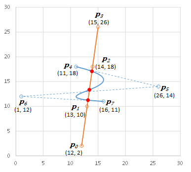</td><td>${\boldsymbol{B}}_0$ が1次 ${\boldsymbol{B}}_0$ is linear  陰伏方程式は3次 Implicit equations are 3rd-degree</td></tr>
<tr><td>Ex.6</td><td>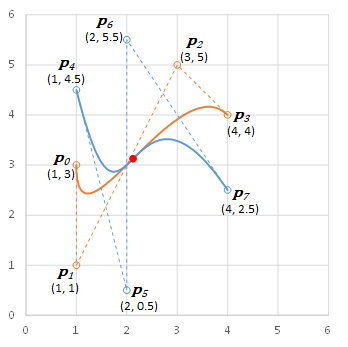</td><td>1点で交差、交点で1次微分が一致 Intersects at one point first derivatives coincide at the intersection  重複数3の重根が含まれる Multiple root with multiplicity of 3 is included</td></tr>
<tr><td>Ex.7</td><td>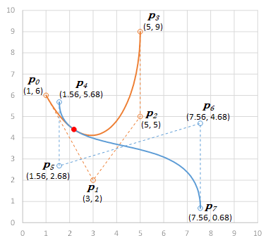</td><td>1点で交差、交点で1次微分が一致 Intersects at one point first derivatives coincide at the intersection  重複数3の重根が含まれる Multiple root with multiplicity of 3 is included</td></tr>
<tr><td>Ex.8</td><td>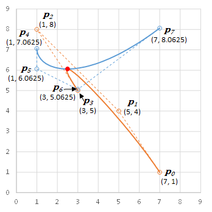</td><td>1点で接触、交点で1次微分が一致 Contacts at one point first derivatives coincide at the contact point  重複数2の重根が含まれる Multiple root with multiplicity of 2 is included</td></tr>
<tr><td>Ex.9</td><td>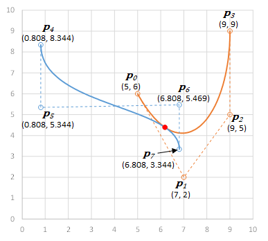</td><td>1点で接触、交点で1次微分が一致 Contacts at one point first derivatives coincide at the contact point  重複数2の重根が含まれる Multiple root with multiplicity of 2 is included</td></tr>
<tr><td>Ex.10</td><td>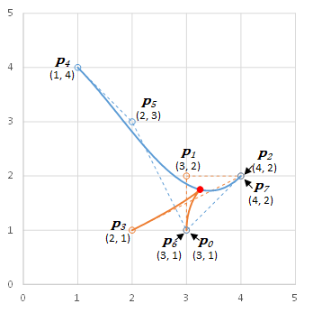</td><td>カスプ点が接触 A cusp point contacts  重複数2の重根が含まれる Multiple root with multiplicity of 2 is included</td></tr>
<tr><td>Ex.11</td><td>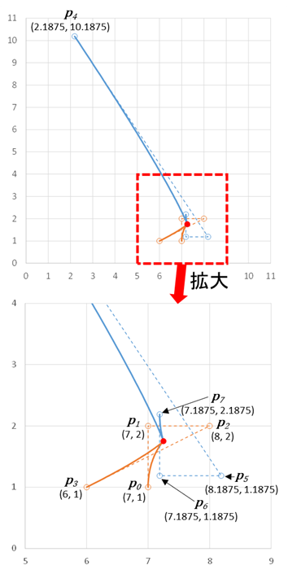</td><td>カスプ点どうし接触 Two cusp points contact each other  重複数4の重根が含まれる Multiple root with multiplicity of 4 is included</td></tr>
</table>
